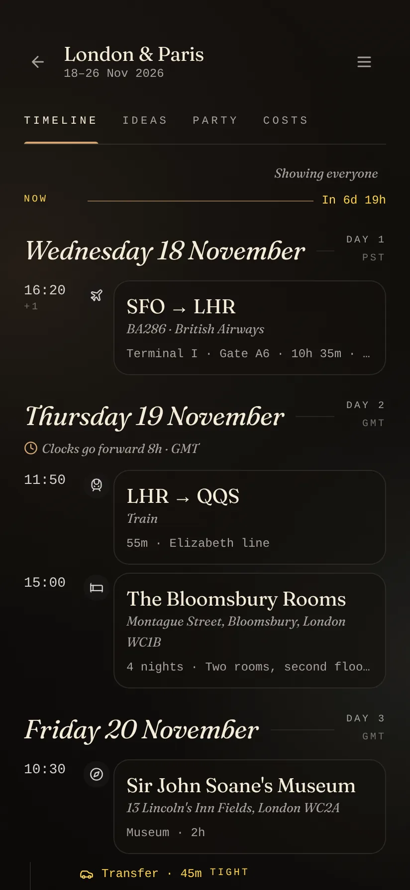
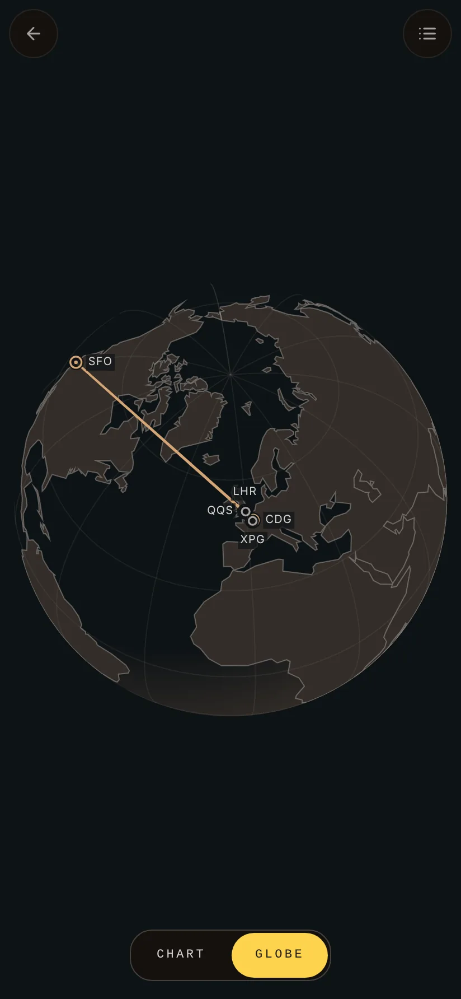
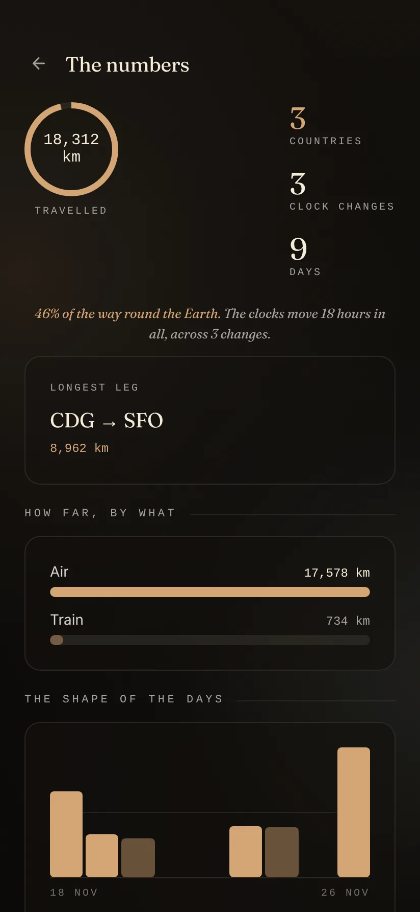
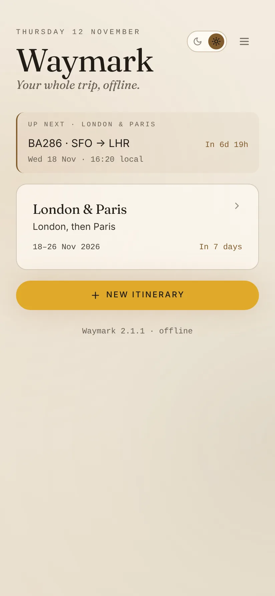

<p align="center"></p>

<h1 align="center">Waymark</h1>

<p align="center"><em>Your whole trip, offline.</em></p>

<p align="center">
  Android&nbsp;·&nbsp;<a href="https://github.com/not-mehul/Waymark/releases/latest">Latest release</a>&nbsp;·&nbsp;MIT&nbsp;·&nbsp;Created by <strong>Mehul Sen</strong>
</p>

---

Waymark is a travel-logistics app for Android. Every flight, stay, transfer and booking for a trip, for one traveler or a party that splits up, sits on one timeline and one map. It calls no schedule service and no tracking API, so it works with the radio off: a booking is a record of something already arranged, kept where you can read it at a gate.

<p align="center">
  
  
  
  
</p>

## Features

### Plan the trip

- **Enter a flight in seconds.** A designator, a date, two airport codes and two times. A bundled directory of 8,831 IATA stations supplies coordinates and time zones, so Waymark knows a 16:20 out of San Francisco lands the next morning and shows the block time back to catch a time entered against the wrong airport.
- **Or don't type it.** Share or paste a confirmation email and Waymark reads the flight numbers, airports, dates and times on the phone. Pick a photo or screenshot of a boarding pass and the barcode fills in the flight, airports, date, cabin and seat. Everything it reads is shown to be checked before it is saved.
- **One question at a time.** Plans and ideas are added through a short flow (what kind, what, when, the reference numbers), and any earlier step can be tapped to correct it. Closing the sheet saves nothing.
- **Places mean what you meant.** Typed places are read against a bundled gazetteer of about 320,000 places: every town of 1,000 people or more, every region, and landmarks, neighbourhoods, islands, mountains, parks and stations. "Eiffel Tower" is pinned on the tower and filed under Paris, "Bloomsbury, London" lands in Bloomsbury, and "Bombay" finds Mumbai. Each place carries its own time zone, so a 15:00 check-in in Paris is 15:00 in Paris. Anything it can't place stays as typed, without a wrong pin.
- **An ideas board.** See, Eat, Do and Shop, saved without a date and read by kind, by place or by day. Each traveler can mark what they want, a day says when it is overfull, and one tap promotes an idea onto the timeline.

### Read the trip

- **One timeline.** A single column of days with the time in the gutter, and between the bookings the parts that go wrong: the connection with a minimum-connection-time verdict, the transfer with a duration estimate, the hours that belong to nobody. Days are numbered, clock changes are called out, and a trip under way has a shortcut to now.
- **Bookings open read only.** Edit turns the screen into a form with Save and Cancel, and nothing is written until Save.
- **Tickets on the booking.** Add a boarding pass picture, a PDF e-ticket or a voucher to any booking, and documents for the whole trip (insurance, a visa). A boarding pass read to fill in a flight is kept with it. At the gate it opens on white at full brightness, with the screen kept on.
- **Find anything.** Search every trip at once by place, hotel, airline, flight or confirmation code.
- **Codes you can read at a desk.** Confirmation codes, record locators and ticket numbers sit on the booking. Tap to copy, or open one large with every character spelt out (Kilo, Seven, Papa), the screen kept on.
- **An offline map, two projections.** A flat chart for a region and a globe for a long haul, both with real coastlines from Natural Earth and great-circle legs on top. Pinch to zoom, drag to pan or turn, tap a mark to open it. Labels are placed by a collision solver, and a list view reads the trip out leg by leg.
- **Land informed.** Currency, plug type, emergency number and driving side for every country a station can be in, and the destination worked out from where the trip actually spends its time, not from the last connection.
- **Numbers.** Distance by mode, the shape of each day, nights per city and a carbon estimate that shows its factors.
- **Your format.** Clock times follow the phone's 12- or 24-hour setting and distances its region. On a tablet or unfolded phone, a booking opens beside the timeline.

### Travel with it

- **Reminders before things start.** Each category has its own lead time (flights three hours out, trains and transfers an hour, a table an hour), plus online check-in a day ahead and a time-to-leave alert worked out from where you are. One exact alarm keeps them on time.
- **The journey on the lock screen.** From shortly before departure until arrival, one ongoing notification counts down and then fills a bar to landing. On Android 16 and later it is a Live Update in the status bar.
- **A home-screen widget** with the next booking across every trip, in three sizes.
- **Travel as a group.** Travelers are profiles (seat and meal preference, loyalty numbers, phone) that belong to the person, not the trip, and are assigned per segment. When the party splits, Waymark names the window and flags anyone with nothing booked.
- **Before you go.** A packing and to-do list for each trip, started from what the destination needs (the plug adapter, the currency), and passports and visas on each traveler's profile, with a warning when one runs out before or during the trip, or leaves under six months.
- **Split the costs.** Log each expense with who paid and who it was for, in any currency, and see the fewest payments that square it.
- **Weather on arrival.** With online extras on, a two-week forecast for where the trip will be, and last year's weather for the same dates beyond that. It is kept for use without a signal.

### Share and keep

- **Take it with you.** Send a trip as Markdown, a calendar file, a trip file another Waymark opens whole, or a QR code for the phone across the table.
- **Print it.** An A4 PDF itinerary with every booking under its day, references, weather and who owes whom.
- **Back up every trip** to one file, and archive trips that are over: no reminders, off the widget, back with one tap. On the phone, a dated backup is also written each week to `Documents/Waymark/Backups`, keeping the newest five.
- **Sync through a folder** you pick, kept the same across phones by Syncthing, Drive or Nextcloud. Trips merge one by one, and a trip deleted on one phone stays deleted.
- **After the trip.** Each city you stayed in can be rated in Ledger or sent to Nookling as a postcard, each with one tap.
- **Links between the apps.** `waymark://open?trip=<id>` opens a trip, and a trip's QR code is a `waymark://import` link. Waymark sends `ledger://add` and `nookling://postcard`.
- **A little delight.** Confetti when a trip is created, an idle compass to play with, and four easter eggs, counted in About. All of it respects reduced motion.

## Private by design

Nothing about a trip leaves the phone unless you share it, or turn on sync through a folder you choose. There are no accounts and no Waymark server. The network is used only for the two optional online extras, weather and exchange rates, and nothing is fetched until you turn them on; a test checks that.

## Good to know

- **Nothing about a booking is live, and the app says so.** Every flight time,
  gate and terminal was typed in by a traveler. The app holds the network
  permission for its two online extras, weather and exchange rates, and makes
  no request at all until they are turned on; a test checks that with them off
  nothing is fetched.
- **Weather beyond two weeks is a year old.** No service forecasts further
  out, so those days show what the same dates were like last year, labelled as
  such. It is a guide to what to pack, not a forecast.
- **Exchange rates are reference rates.** The European Central Bank's daily
  rates cover about thirty currencies and are not what a card or a bureau
  charges. A rate from a receipt can be typed in, and a typed rate is never
  replaced by a live one.
- **Offline cuts both ways.** The weekly backup stays on the phone, in
  Documents. A trip only leaves the phone when it is shared, backed up to a
  file you move, or synced through a folder, so a lost phone with none of
  those is a lost trip. The About sheet says this too, rather than leaving it
  to be discovered after the fact.
- **The email reader skims; it does not understand.** It finds a flight number
  from an airline it knows with an airport code beside it, and the nearest
  date and times. An unusual layout can defeat it, which is why what it finds
  is shown to be checked rather than saved unseen.
- **English only, for now.** Clock times and distances follow the phone's
  settings, but the words are English and live in the code rather than in
  string resources; translating the app starts with moving them.
- **The coastline is 1:110m and coarse.** Italy is a boot and Florida is a
  peninsula; it is not a navigational chart and no place is drawn to a
  resolution finer than about fifty kilometres. It is a basemap for reading a
  trip against, not for finding anything by.
- **Six hundred station names lost their accents before the file reached us.**
  The supplied CSV contains literal replacement characters where accented
  letters used to be — "Kōchi Ryōma" arrived as `K����chi Ry����ma` — so the
  runs are stripped rather than guessed at. Codes, coordinates and time zones
  are unaffected, and the municipality is usually intact.
- **The carbon figure is a model, and says so on screen**, with its per-mode
  factors printed beside it. Lodging and meals are excluded rather than guessed.
- **The country notes are four facts, not a guidebook.** Money, plug,
  emergency number, which side of the road — chosen because they are true of a
  whole country, do not go stale between releases, and are not somebody's
  opinion. There used to be a bundled city guide with neighbourhoods to stay in
  and dishes to order; it covered nine cities, it was one person's taste, and an
  offline app has no way to correct it. Emergency numbers are the commonly
  published primary number, and several countries run separate lines for
  police, fire and ambulance.

## Install

Download the signed APK from the [latest release](https://github.com/not-mehul/Waymark/releases/latest) and open it on your phone. Waymark targets Android 17 and runs on Android 8 and later. Updating from the old Kotlin app keeps your trips: the rewrite has the same id and signing key, and moves your data across the first time it opens.

## The Dusk & Dawn apps

Waymark is one of six apps by Mehul Sen that share one design system, [Editorial Dusk & Dawn](https://github.com/not-mehul/dusk-dawn), and a common link scheme, so they can hand things to each other.

| App | What it is for |
|---|---|
| [Waymark](https://github.com/not-mehul/Waymark) | Your whole trip, offline: flights, stays, plans and costs on one timeline |
| [BookShelf](https://github.com/not-mehul/BookShelf) | Books, films, shows and the lines worth keeping |
| [Ledger](https://github.com/not-mehul/Ledger) | A record of cities, scored on what matters to you |
| [Colophon](https://github.com/not-mehul/Colophon) | Inspect, fix and rebind EPUB editions |
| [Rosetta](https://github.com/not-mehul/Rosetta) | A quiet library and reader for books, papers and notes |
| [Mise](https://github.com/not-mehul/Mise) | Recipes from anywhere, cooked one step at a time |

## Build from source

Svelte 5 and TypeScript in a Capacitor 8 shell, with IndexedDB (through Dexie) for storage and a small Kotlin plugin for reminders, the widget, the journey notification and barcode reading. You need Node 24.

```sh
npm ci
npm run dev        # the app in a browser, at http://localhost:5173
npm run check      # tokens and contrast, formatting, lint, types, tests, build
npm run sync       # build the page into android/, then open it in Android Studio
npm run android:apk  # a debug APK, in android/app/build/outputs/apk/debug/
```

[docs/DEVELOPMENT.md](docs/DEVELOPMENT.md) covers the design, the architecture, the Android build and the tests. [RELEASING.md](RELEASING.md) covers signing and releases.

## Credits

Waymark is designed and built by **Mehul Sen** ([@not-mehul](https://github.com/not-mehul)).

- Coastlines: [Natural Earth](https://www.naturalearthdata.com) 1:110m land polygons, public domain.
- Places: [GeoNames](https://www.geonames.org), CC BY 4.0, shared through `dusk-dawn/places`.
- The station directory, airline names and country notes are compiled for the project.
- Icons: [Lucide](https://lucide.dev), ISC.
- Fonts and design: Fraunces (SIL Open Font License) through [dusk-dawn](https://github.com/not-mehul/dusk-dawn).

The same credits appear in the app, under the version line at the foot of the trip shelf.

## Licence

[MIT](LICENSE) © 2026 Mehul Sen. The bundled data keeps its own terms, listed above.
